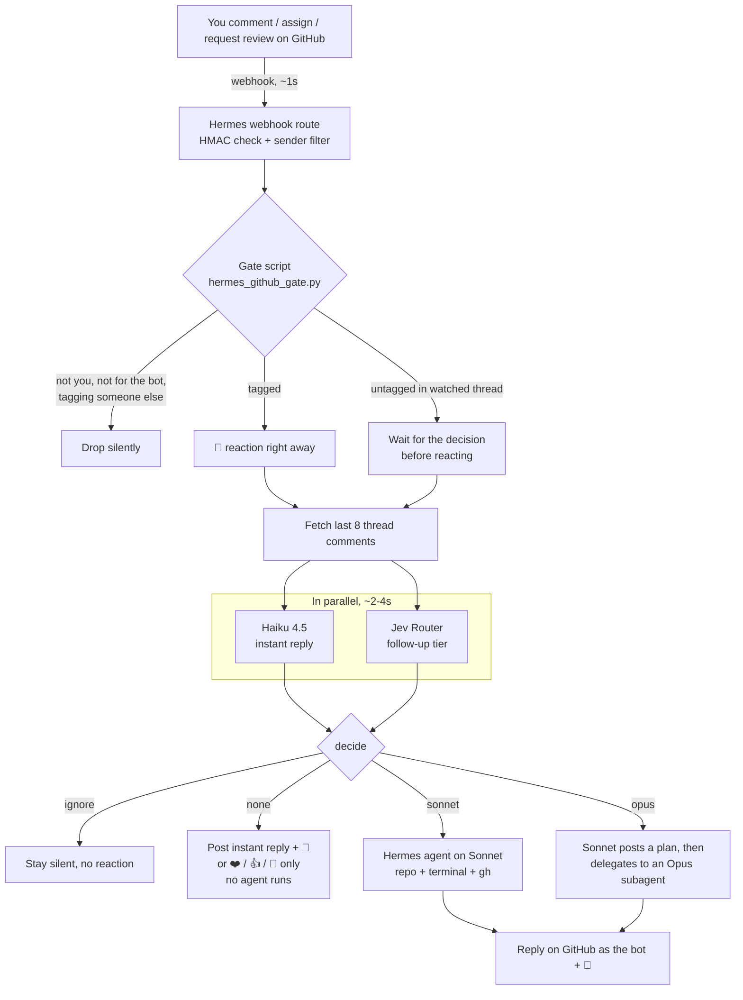
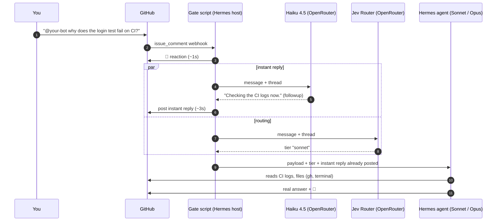

# hermes-github-bridge

Turn a [Hermes Agent](https://hermes-agent.nousresearch.com/docs) into a GitHub teammate. Tag the bot, assign it, or request its review, and it reacts within a second, answers simple things within a few seconds, and hands real work to a stronger model. Everything happens on GitHub: replies, reactions, reviews.

The bot's GitHub account, name, owner, and repos all come from one config file, so it works with any Hermes setup.

Only one GitHub user (the owner) can wake the bot. Everyone else is ignored before any model is called.

## What wakes the bot

- `@<bot>` (or `/hermes`) in a comment, inline review comment, review summary, or a new or edited issue or PR description.
- Assigning the bot to an issue or PR.
- Requesting a review from the bot.
- **Any** comment the owner writes in a thread the bot is already part of (assigned, asked to review, or commented there before). No tag needed.

It stays out when:

- someone other than the owner writes,
- the owner tags someone else and not the bot (`@teammate can you look`),
- an untagged comment in a watched thread isn't meant for it (a note to self, a todo). Both models must agree it's not for the bot.

## How it works



### Timeline of one mention



### The tiers

| Tier | Who answers | When | Typical time |
|---|---|---|---|
| ignore | nobody | untagged and clearly not for the bot | 0 |
| none | Haiku, via the gate | greetings, thanks, general-knowledge questions | ~3-7s |
| sonnet | Hermes agent (Sonnet) | bounded repo work: read files, check CI, small fix, normal review | ~10s to minutes |
| opus | Opus subagent | multi-file work, deep debugging, design, large reviews | minutes |

Safety rules baked into [`decide()`](gate/hermes_github_gate.py):

- If Haiku's reply promises more work ("checking the logs now"), a follow-up always runs, even if Jev says `none`.
- Assignments and review requests are never `none`.
- If Jev fails twice, the tier falls back to `sonnet`. If Haiku fails, a follow-up runs.
- With no config file, the gate drops every event.
- Every routing decision is appended to a JSONL log (tier, reason, model Jev picked, latency, errors).

### Why two models in parallel

Haiku is fast and consistent but has no repo access, so it can't be trusted to decide alone whether something needs real work. [Jev Router](https://openrouter.ai/typesafe/jev-router) is a stronger judge of that but slower, and it picks a different underlying model each time, so its text isn't used for replies. Running both at once gives a reply in about 3 seconds and a routing decision in about 3-4 seconds, instead of stacking them.

## Pieces

| Path | What it is | Where it runs |
|---|---|---|
| [`gate/hermes_github_gate.py`](gate/hermes_github_gate.py) | Hermes webhook route `script:`. Filters, reacts, fetches the thread, calls Haiku and Jev, posts instant replies, hands the rest to the agent. Stdlib only. | Hermes host, per request (changes are live immediately) |
| [`deploy/routes.py`](deploy/routes.py) | Writes the webhook routes (prompt, toolsets, profile) into Hermes `config.yaml`. Idempotent, keeps secrets, makes a backup. | Hermes host (needs a gateway restart) |
| [`deploy/install.sh`](deploy/install.sh) | Ships the gate, its config, and optionally the routes to the Hermes host. | Your machine |
| [`deploy/github_hooks.sh`](deploy/github_hooks.sh) | Creates the GitHub webhooks for the repos in your config. | Your machine |
| [`config.example.json`](config.example.json) | Everything deployment-specific: bot, owner, host, routes, repos. | Copy to `config.json` (git-ignored) |
| [`tests/`](tests) | Offline tests, all network calls faked. | Anywhere |

## Set it up yourself

### Prerequisites

- A running [Hermes Agent](https://hermes-agent.nousresearch.com/docs) gateway with the [webhook platform](https://hermes-agent.nousresearch.com/docs/user-guide/messaging/webhooks) enabled, reachable from GitHub.
- `gh` and `git` on the Hermes terminal backend, logged in as **you** (commits and PRs stay under your name).
- A second GitHub account for the bot, added as a collaborator with write access on each repo. Give it a classic token with `repo` and `read:org`.
- An [OpenRouter](https://openrouter.ai) key as `OPENROUTER_API_KEY` in the Hermes `.env`. Instant replies cost about $0.001 each.

### Steps

1. Copy the config and fill it in:
   ```bash
   cp config.example.json config.json
   ```
   - `bot_login`, `bot_name`, `owner_login`
   - `hermes`: ssh host and key for the Hermes host, and the public webhook base URL
   - `gate.token_file`: where the bot token lives **on the Hermes host**
   - `agent_token_path`: where the bot token lives **on the terminal backend** the agent uses (can be a different machine)
   - `routes`: one per Hermes profile you want. `profile: null` is the default profile. `opus_subagent: true` adds the delegation toolset; also set `delegation.model` in that profile's Hermes config.
   - `repos`: which repo goes to which route
2. Put the bot token in both places and lock it down (`chmod 600`).
3. Ship it and restart the gateway once:
   ```bash
   deploy/install.sh --routes
   # then, from a shell that is NOT a Hermes session:
   ssh <hermes-host> 'systemctl restart hermes-gateway'
   ```
4. Create the webhooks:
   ```bash
   deploy/github_hooks.sh
   ```
5. Tag the bot on a scratch issue. You should see 👀 within a second and a reply within a few seconds.

## Operating it

```bash
# tests (needs pyyaml for the routes tests)
python3 -m unittest discover -s tests -v

# ship a gate change: live right away
deploy/install.sh

# ship a route or prompt change, then restart the gateway from a separate shell
deploy/install.sh --routes

# add a repo: invite the bot with write access, add it to "repos" in config.json, then
deploy/github_hooks.sh owner/repo

# watch routing decisions on the Hermes host
tail -f ~/.hermes/logs/github-router.jsonl
```

Never restart the gateway from inside a Hermes chat session. It kills the session that's running the command.

### Hermes details worth knowing

- Profile-bound routes resolve `script:` inside that profile's own `scripts/` dir and reject symlinks pointing outside it. `install.sh` uses hardlinks.
- `gh issue comment` and `gh pr comment` go through GraphQL and need `read:org`. The prompts post through the REST API instead.
- Hermes's built-in `deliver: github_comment` uses `gh pr comment`, which fails on issues, so routes use `deliver: log` and the agent posts itself.
- Profile-bound routes can't deliver to a messaging platform unless that profile has its own adapter configured.

## Known limits

- Many inline comments in one self-review in a watched thread wake the bot once per comment. Notes not meant for it are filtered, but it can still be noisy.
- Plain-HTTP webhook URLs are protected against forgery by HMAC signatures, not against eavesdropping. Put the webhook port behind TLS if you can.
- Threads longer than 100 comments only check the first page when deciding whether the bot is part of the thread.

## License

[MIT](LICENSE)
